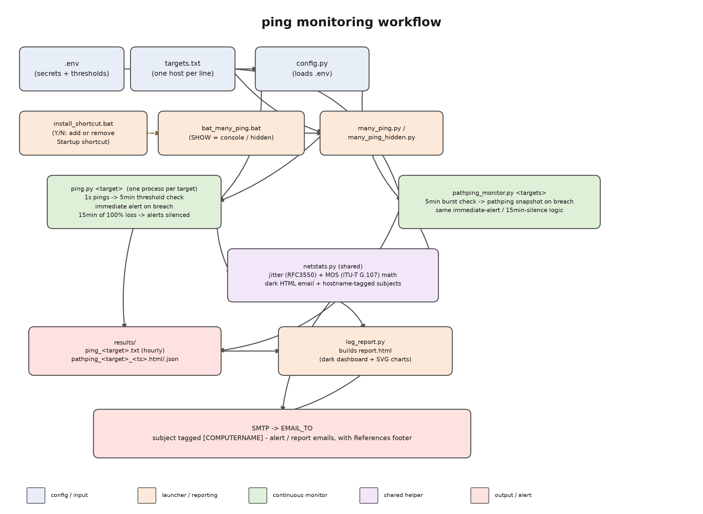

# ping

Automated network monitoring for Windows: continuous ICMP ping per target, threshold-based email alerts, hop-by-hop `pathping` diagnostics on breach, and a dark-themed HTML dashboard.

## Components

| File | Role |
|---|---|
| `ping.py` | Continuous single-target monitor. Pings once a second; every 5 minutes (`MONITOR_INTERVAL`) checks packet loss/latency against thresholds and emails immediately on breach. After `SUPPRESS_STREAK` straight cycles breaching the **same** metric (default 3) it goes silent until the target recovers, then sends one `RECOVERED` mail and re-arms - it keeps testing the whole time. Logs an hourly summary to `results/ping_<target>.txt`. Also triggers `log_report.py` every `REPORT_INTERVAL_HOURS`. |
| `pathping_monitor.py` | Continuous multi-target monitor (reads `targets.txt`). Runs a quick `ping3` burst every cycle; on a threshold breach, shells out to Windows `pathping` for a hop-by-hop snapshot, flags suspect hops (RTT jumps, per-hop loss), and emails a dark HTML report with the snapshot attached. Same per-metric suppression / `RECOVERED` mail / daily-report behavior as `ping.py`. |
| `netstats.py` | Shared helpers: jitter (RFC 3550) and MOS (ITU-T G.107 approximation) math, target-list parsing, the dark HTML email palette, `[COMPUTERNAME]`-tagged subjects, the references footer, the per-target `AlertSuppressor`, and `maybe_run_daily_report()`. |
| `log_report.py` | Standalone dashboard builder. Reads everything under `results/` (hourly `.txt` logs + `pathping` `.json` snapshots) and renders `results/report.html` - per-target stats, an SVG latency-over-time chart, and an incident table. Emails the report by default; pass `--no-email` to just write the file. |
| `many_ping.py` | Spawns a persistent `python -u ping.py <target> [isp_name]` process per line in a targets file, each in its own visible console window. |
| `many_ping_hidden.py` | Same, but fully detached/hidden (no console window); output goes to `many_ping.log`. |
| `bat_many_ping.bat` | Entry point. Reads `RUN_MODE` (`hidden`/`show`), `RUN_PATHPING` (`Y`/`N`), `PYTHON_PING`/`PYTHON_PATHPING` and `NUM_LINKS`/`ISPnn` from `.env`. Runs one `many_ping.py`/`many_ping_hidden.py` per link and, when `RUN_PATHPING=Y`, also launches `pathping_monitor.py` as its own process. **Verbs:** no arg = guarded start (no-ops if monitors are already up); `restart` = stop then start from the current `targets*.txt`; `stop` = kill this folder's monitors. `stop`/`restart` self-elevate so they also reach SYSTEM-run monitors. |
| `install_ping.bat` | One-time setup: multi-link/ISP config, an interactive Python interpreter picker (`select_python.ps1`), console visibility, `Run pathping alongside ping? [Y/N]`, and how monitoring starts - **1)** Scheduled Task (runs **as SYSTEM**, no user interaction: `PingMonitor` at logon, `PingMonitor-Daily` at 18:00 does `bat_many_ping.bat restart` so edited `targets*.txt` take effect and anything closed comes back, `PingMonitor-DailyReport` at 18:00), **2)** Start Menu shortcut, or **3)** manual. A Desktop shortcut is created in every case. Reruns show current values as defaults. Note: SYSTEM tasks run in session 0, so with option 1 monitoring is always hidden regardless of `RUN_MODE`. |
| `uninstall_ping.bat` | Removes the `PingMonitor` / `PingMonitor-Daily` / `PingMonitor-DailyReport` scheduled tasks and the Start Menu / Desktop shortcuts if present (self-elevates for the tasks). Leaves `.env`, `targets*.txt` and `results/` alone. |
| `stop_background_ping.bat` | Emergency stop for hidden-mode monitoring (no console window to Ctrl+C). Self-elevates, then kills **every** `python.exe`/`python3.exe` process on the machine - not just this project's. If you run Python here for other jobs, they get killed too; either stop those yourself first, or use `bat_many_ping.bat stop` instead, which only targets this folder's monitors. `install_ping.bat` prints a note about this whenever hidden mode is selected. |
| `select_python.ps1` | Helper for `install_ping.bat` - discovers installed `python.exe` builds, shows a numbered menu, checks each for `ping3`, and writes the chosen paths back. |
| `config.py` | Loads `.env` and exposes SMTP credentials + monitoring thresholds + `SUPPRESS_STREAK` / `REPORT_INTERVAL_HOURS` to the other scripts. |
| `targets.txt.example` | Template for `targets.txt` / `targetsNN.txt`: one host per line; `#` starts a comment, so targets can be toggled by commenting/uncommenting. The real `targets.txt` (single link, `NUM_LINKS=1`, the default) and `targetsNN.txt` files are gitignored; `install_ping.bat` creates them from this template if they're missing. |
| `.env` / `.env.example` | SMTP credentials, thresholds (`LOSS_THRESHOLD`, `LATENCY_THRESHOLD`, `JITTER_THRESHOLD`, `MOS_THRESHOLD`, `MONITOR_INTERVAL`), suppression (`SUPPRESS_STREAK`, `REPORT_INTERVAL_HOURS`), runtime settings (`RUN_MODE`, `RUN_PATHPING`, `PYTHON_PING`, `PYTHON_PATHPING`) and multi-link setup (`NUM_LINKS`, `ISPnn`). `.env` is git-ignored - copy `.env.example` and fill in real values. |
| `ping_monitor_install.bat` / `.ps1`, `uninstall_ping.ps1` | Older, standalone bootstrap scripts that download Python + `ping3` + `ping.py` from GitHub on a fresh machine and can remove them again. Independent of the `bat_many_ping.bat` flow above. |

## Setup

1. Copy `.env.example` to `.env` and fill in real SMTP credentials and thresholds.
2. Copy `targets.txt.example` to `targets.txt` (or let `install_ping.bat` do it in step 3) and edit it with the hosts you want monitored (comment out any you don't). With multiple links, edit `targets01.txt`, `targets02.txt`, ... instead.
3. Run `install_ping.bat` once - pick the Python interpreter(s), console mode, whether to run pathping alongside, and how monitoring should start.
4. Start monitoring: with the Scheduled Task option a separate elevated window creates the tasks, runs `schtasks /Run /TN "PingMonitor"` to start immediately, and pauses so you can read the result (the command is also echoed as a reminder); otherwise run `bat_many_ping.bat` or the Desktop shortcut.
5. Run `python log_report.py` any time to build/email the dashboard from everything logged so far (the monitors also do this automatically every `REPORT_INTERVAL_HOURS`).

**After editing any `targets*.txt`:** running monitors don't re-read the file - each is a persistent `ping.py` per target spawned at launch. Run `bat_many_ping.bat restart` to reload (the `PingMonitor-Daily` task also does this at 18:00).

## Alerting behavior

Every monitor sends an email **immediately** the first time a threshold is breached (loss, latency, jitter, or MOS). If the **same** metric keeps breaching, the target is silenced after `SUPPRESS_STREAK` consecutive cycles (default 3) so a persistent fault doesn't spam the inbox every cycle - monitoring keeps running silently. Each metric is tracked separately, so e.g. a latency problem doesn't mask a later loss problem. When the target comes back fully within thresholds it sends one `RECOVERED` mail and immediate alerting re-arms automatically.

Independently, each running monitor triggers `log_report.py` every `REPORT_INTERVAL_HOURS` (default 24) whether or not anything is failing, tracked by a `results/.last_report` stamp so it fires once per interval even across multiple monitor processes. On a fresh `results/` (no stamp yet), the first report waits 15 minutes instead of firing on the very next cycle, so it isn't built from a few seconds of data.

Every alert and report subject is tagged with the sending machine's name, e.g. `Pathping Alert 8.8.8.8 [DESKTOP-ABC123]`, so multi-host setups stay distinguishable in a shared inbox.

## ICMP error replies count as loss

`ping.py` and `pathping_monitor.py`'s quick check both use `ping3`. By default `ping3.ping()` returns `False` (not `None`) when it gets back a real ICMP *error* reply - Destination Unreachable, TTL Expired, etc. - instead of an Echo Reply. Left unhandled, `False * 1000 == 0`, so that error would get recorded as a genuine successful 0ms ping instead of a loss - exactly the kind of "is this ICMP response actually a working reply" mixup worth checking for when a device might reply with something other than a real Echo Reply. Both scripts now set `ping3.EXCEPTIONS = True` and catch the specific exception types, so an ICMP error reply is counted as loss like a timeout, and pathping's alert email lists the specific error(s) received (e.g. `Destination unreachable: Host unreachable.`) under "ICMP errors seen" and in the "Triggered by" line.

## Reading a pathping report

In the hop-by-hop table, a hop is highlighted **red** if it shows packet loss, **amber** if it's flagged suspect for another reason (e.g. an RTT jump), and **green** for the last clean hop right before the first flagged one - the boundary where the path was still fine.

If the target itself is silently dropping or deprioritizing ping traffic (rate limiting, ICMP policy, a host firewall, etc.), `pathping` won't necessarily show it as a failing hop, and the report handles two different cases:

- **pathping's trace reaches the target directly, but shows it clean.** The last hop's address matches the target, yet the quick check that triggered the run clearly breached thresholds. Expected pathping behavior, not a bug: the destination is the last hop in the path, so if it just doesn't reply, there's no hop *beyond* it for pathping to pin the loss on. The report calls this out with a note and highlights that last hop red.
- **pathping's trace never reaches the target at all.** The path just goes dark after some earlier hop (e.g. target `203.0.113.50` monitored, but the last hop pathping could print was a different address, `198.51.100.82`, one hop short of the destination). In this case that last responding hop is the **last known-good hop** - highlighted green, not flagged - and the report appends a synthetic `* <target>` row marked `(target)` and highlighted red as the actual failure point, instead of wrongly blaming the hop that answered fine.

## Multi-link / multi-ISP setup

Some gateways use policy-based routing so different groups of targets leave through different ISP links - useful for testing each ISP independently. Run `install_ping.bat` and answer **"How many internet links / ISPs do you have?"**:

- **1 link (default)** - nothing changes: `bat_many_ping.bat` runs `many_ping.py`/`many_ping_hidden.py` once against `targets.txt`, and `pathping_monitor.py` (run with no arguments) reads `targets.txt` too, same as always.
- **2+ links** - each link *N* gets its own `targetsNN.txt` file (`targets01.txt`, `targets02.txt`, ...; link 1 seeds from the existing `targets.txt` if present, otherwise from `targets.txt.example`) and an optional ISP name prompted per link, saved as `ISP01`, `ISP02`, ... in `.env` alongside `NUM_LINKS`. Edit each `targetsNN.txt` with the hosts that link actually routes to. `bat_many_ping.bat` then runs one `many_ping.py`/`many_ping_hidden.py` per link, and `pathping_monitor.py` (run with no arguments) monitors every `targetsNN.txt` at once in one process. Either way, alerts for a link's targets get that link's ISP name in the subject, e.g. `Ping Alert 8.8.8.8 [Vivo Fibra] [DESKTOP-ABC123]` / `Pathping Alert 8.8.8.8 [Vivo Fibra] [DESKTOP-ABC123]`.

Passing an explicit targets file to `pathping_monitor.py` (`python pathping_monitor.py "" targets01.txt`) or a single target (`python pathping_monitor.py 8.8.8.8`) always bypasses `NUM_LINKS` and skips the ISP tag, same as before.

Re-running `install_ping.bat` shows your current link count, ISP names, interpreter paths and run mode as defaults (press Enter to keep them), so it's safe to rerun just to change one thing.
